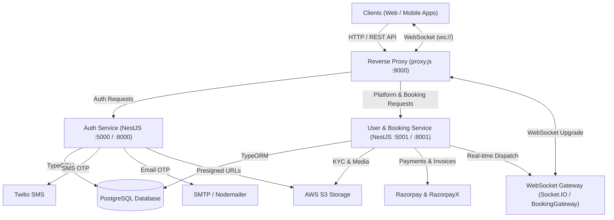

# HiChandra

[](https://www.typescriptlang.org/)
[](https://nestjs.com/)
[-339933?logo=nodedotjs&logoColor=white)](https://nodejs.org/)
[](https://www.postgresql.org/)
[](https://typeorm.io/)
[](https://socket.io/)
[](https://razorpay.com/)
[](https://aws.amazon.com/s3/)

A modular backend platform for on-demand home services, featuring geolocation-based technician dispatch, dynamic pricing calculation, and multi-channel payment management.

---

## Key Features

- **Authentication & Security**: Multi-identifier login (email or phone), dual-channel OTP verification (Twilio SMS with Nodemailer fallback), dual-token JWT sessions (15-min access, 7-day refresh), session revocation via `tokenVersion`, and portal-level access segregation.
- **Geolocation & Real-Time Dispatch**: Haversine distance matching against technician service radii (`serviceRadiusKm`), real-time job alerts over Socket.IO WebSockets, and manual admin assignment overrides.
- **Dynamic Pricing Engine**: Itemized fee calculation including service base price, distance charges beyond free buffers, emergency rates, peak-hour windows, weekend multipliers, surge factors, platform commissions, and GST.
- **Booking State Machine**: Full lifecycle tracking (`PENDING` -> `ACCEPTED` -> `ENROUTE` -> `ARRIVED` -> `ONGOING` -> `COMPLETED`, `CANCELLED`, `REJECTED`) with start/completion OTP verification.
- **Payments & Invoicing**: Razorpay customer checkout links, cryptographic webhook validation (HMAC SHA-256), cash payment reconciliation, admin-initiated technician payouts via RazorpayX or manual logging, and automated PDF invoice generation with Puppeteer.
- **Platform Governance**: Centralized audit logging (`audit_logs`), KYC document storage via AWS S3 presigned URLs, customer complaints handling, and dual-party review and rating aggregation.

---

## Technology Stack

| Category | Technology | Declared Range | Resolved Version | Purpose |
|---|---|---|---|---|
| **Runtime** | Node.js | `>= 20.0.0` (Tested on `v24.14.1`; LTS 26 recommended) | System | Server-side JavaScript runtime |
| **Framework** | NestJS | `^11.0.1` | `11.1.17` | Modular enterprise backend architecture |
| **Language** | TypeScript | `^5.7.3` | `5.9.3` | Application codebase and static typing |
| **Database** | PostgreSQL | `>= 14.x` | External | Relational data persistence with JSONB support |
| **ORM** | TypeORM | `^0.3.28` | `0.3.28` | Entity mapping, repositories, and relations |
| **Real-time** | Socket.IO | `^4.8.3` | `4.8.3` | Low-latency bi-directional WebSocket gateway |
| **Reverse Proxy** | http-proxy | `^1.18.1` | `1.18.1` | Reverse proxy path routing and WebSocket upgrade |
| **Payments** | Razorpay SDK | `^2.9.6` | `2.9.6` | Payment link generation and customer checkout |
| **Payouts** | Axios | `^1.13.6` | `1.13.6` | Direct REST API integration with RazorpayX |
| **Object Storage** | AWS SDK S3 | `^3.995.0` | `3.1012.0` | KYC document storage and presigned download URLs |
| **SMS Gateway** | Twilio SDK | `^6.0.2` | `6.0.2` | SMS OTP dispatch |
| **Email Delivery** | Nodemailer | `^6.10.1` | `6.10.1` | SMTP email notifications and OTP fallback |
| **Document Rendering** | Puppeteer | `^25.3.0` | `25.3.0` | Headless Chrome engine for PDF invoices |
| **Cryptography** | bcryptjs | `^3.0.3` | `3.0.3` | Password and refresh token hashing |

---

## Architecture Overview

The backend uses a NestJS monorepo structure coordinated by a reverse proxy (`proxy.js`):

- **Auth Service (`auth-service`)**: Default port `5000` (reverse proxy upstream default `8000`). Handles registration, OTP issuance, JWT authentication, and password management.
- **User & Booking Service (`user-service`)**: Default port `5001` (reverse proxy upstream default `8001`). Coordinates user profiles, technician KYC, address geolocation, booking lifecycles, payments, and the Socket.IO `BookingGateway`.
- **Reverse Proxy (`proxy.js`)**: Public entry point listening on port `9000`. Routes traffic to the upstream microservices and proxies WebSocket upgrade requests directly to the User & Booking Service.



---

## Project Structure

```text
hi-chandra-backend/
├── apps/
│   ├── auth-service/               # Authentication, OTP & token management (Port 5000 / 8000)
│   └── user-service/               # Core platform: bookings, users, payouts & WebSockets (Port 5001 / 8001)
├── libs/
│   ├── common/                     # Shared guards, exception filters, interceptors & audit service
│   ├── database/                   # TypeORM PostgreSQL configuration
│   ├── dtos/                       # Shared validation DTOs (class-validator)
│   ├── email-services/             # Nodemailer SMTP email delivery provider
│   ├── entities/                   # TypeORM database schema entities & enums
│   ├── gateway/                    # Socket.IO WebSocket booking gateway
│   ├── notification/               # In-app notification creation & repository
│   ├── payment/                    # Razorpay, RazorpayX & Puppeteer PDF invoices
│   ├── repositories/               # Custom TypeORM repository access layer
│   ├── s3/                         # AWS S3 client & presigned URL generators
│   └── sms-services/               # Twilio client & SMS OTP dispatch provider
├── nest-cli.json                   # NestJS monorepo project configuration
├── package.json                    # Workspace scripts and dependencies
├── proxy.js                        # Reverse proxy & WebSocket router
└── tsconfig.json                   # Base TypeScript compiler configuration
```

---

## Getting Started

### Prerequisites

- **Node.js**: Requires Node.js `>= 20.0.0` (NestJS 11 requires Node.js 20+; Node 18 and earlier versions are EOL). Tested locally on Node.js `v24.14.1`; Active LTS Node.js 26 is recommended as of November 2026.
- **Package Manager**: `npm` (`v10.x`+).
- **Database**: PostgreSQL `14` or higher.
- **External Services** (optional for local testing): AWS S3, Razorpay Test Mode, Twilio, and SMTP credentials.

### Installation & Environment Setup

1. **Clone the repository**:
   ```bash
   git clone https://github.com/its-chiranjeev/HiChandra.git
   cd HiChandra
   npm install
   ```

### Environment Configuration & Port Alignment

Create a `.env` file at the root.

> **Port Alignment**:
> - Standalone defaults: `auth-service` listens on port `5000` (`AUTHENTICATION_PORT || 5000`) and `user-service` listens on port `5001` (`USER_MANAGEMENT_PORT || 5001`).
> - Reverse proxy defaults: `proxy.js` listens on port `9000` (`PROXY_PORT || 9000`), routing to upstream targets `8000` for Auth and `8001` for User.
> - To ensure the reverse proxy routes traffic correctly, align these ports in `.env`:
> ```dotenv
> AUTHENTICATION_PORT=8000
> USER_MANAGEMENT_PORT=8001
> PROXY_PORT=9000
> ```

### Running the Application

> **Script Note**: The default `package.json` scripts (`start:dev:all`, `start:dev:auth`, `start:dev:main`) reference legacy project targets (`auth` and `main`). In this workspace, `nest-cli.json` defines the projects as `auth-service` and `user-service`. Start each service using its actual monorepo project name:

```bash
# Terminal 1: Authentication Service
npx nest start auth-service --watch

# Terminal 2: User & Booking Service
npx nest start user-service --watch

# Terminal 3: Reverse Proxy
node proxy.js
```

### Production Build & Execution

```bash
# Compile both microservices
npx nest build auth-service
npx nest build user-service

# Run compiled applications directly
node dist/apps/auth-service/main.js
node dist/apps/user-service/main.js
node proxy.js
```

---

## Environment Variables

| Variable | Required / Optional | Default (if unset) | Purpose |
|---|:---:|---|---|
| `NODE_ENV` | Optional | `undefined` | Set to `production` to enforce restricted CORS policies. |
| `AUTHENTICATION_PORT` | Optional | `5000` (Nest) / `8000` (Proxy) | HTTP port for the Authentication service. |
| `USER_MANAGEMENT_PORT` | Optional | `5001` (Nest) / `8001` (Proxy) | HTTP port for the User & Booking service. |
| `PROXY_PORT` | Optional | `9000` | Listening port for the reverse proxy. |
| `DB_HOST` | **Required** | None | PostgreSQL database host address. |
| `DB_USERNAME` | **Required** | None | PostgreSQL database username. |
| `DB_PASSWORD` | **Required** | None | PostgreSQL database password. |
| `DB_NAME` | **Required** | None | PostgreSQL database name. |
| `JWT_SECRET` | **Required** | None | Primary/fallback HMAC key for JWT signing. |
| `JWT_ACCESS_SECRET` | Optional | Falls back to `JWT_SECRET` | Dedicated secret for signing 15-minute access tokens. |
| `JWT_REFRESH_SECRET` | Optional | Falls back to `JWT_SECRET` | Dedicated secret for signing 7-day refresh tokens. |
| `TWILIO_ACCOUNT_SID` | **Required** | None | Twilio Account SID for SMS OTP delivery. |
| `TWILIO_AUTH_TOKEN` | **Required** | None | Twilio Auth Token for SMS API access. |
| `TWILIO_PHONE_NUMBER` | **Required** | None | Registered Twilio sender phone number. |
| `SMTP_USERNAME` | Optional | None | SMTP username for Nodemailer transactional emails. |
| `SMTP_PASSWORD` | Optional | None | SMTP password for authentication. |
| `EMAIL_FROM` | Optional | Falls back to `SMTP_USERNAME` | Sender email address displayed on outbound emails. |
| `AWS_S3_BUCKET_NAME` | **Required** | None | AWS S3 bucket name for document and image storage. |
| `AWS_ACCESS_KEY_ID` | **Required** | None | AWS IAM Access Key ID. |
| `AWS_SECRET_ACCESS_KEY` | **Required** | None | AWS IAM Secret Access Key. |
| `AWS_S3_ENDPOINT` | **Required** | None | S3 endpoint URL (throws if unset in S3Service; supports MinIO, R2, or AWS). |
| `AWS_REGION` | Optional | `'auto'` | S3 region. Fallback in constructor is `'auto'` (valid for R2/MinIO; set to an AWS region like `ap-south-1` for standard AWS). |
| `RAZORPAY_KEY_ID` | Optional | `''` | Razorpay API Key ID. |
| `RAZORPAY_KEY_SECRET` | Optional | `''` | Razorpay API Secret key. |
| `RAZORPAY_WEBHOOK_SECRET` | Optional | `''` | Secret for verifying payment webhook signatures (HMAC SHA-256). |
| `RAZORPAYX_ACCOUNT_NUMBER` | Optional | `''` | Business source account number for RazorpayX payouts. |
| `FRONTEND_PAYMENT_CALLBACK_URL` | Optional | `undefined` | Redirect callback URL for Razorpay payment links. |
| `HICHANDRA_COMPANY_NAME` | Optional | `'HiChandra'` | Company name displayed on generated PDF invoices. |
| `HICHANDRA_COMPANY_EMAIL` | Optional | `'-'` | Support email displayed on generated PDF invoices. |
| `HICHANDRA_COMPANY_PHONE` | Optional | `'-'` | Customer support phone displayed on PDF invoices. |
| `HICHANDRA_COMPANY_ADDRESS` | Optional | `'-'` | Business address displayed on PDF invoices. |
| `HICHANDRA_GSTIN` | Optional | `'-'` | Company GSTIN displayed on PDF invoices. |

---

## Testing & Verification

Testing is configured with **Jest** and `ts-jest`:

```bash
# Unit tests
npm test

# Watch mode
npm run test:watch

# Code coverage
npm run test:cov

# E2E test suites
npm run test:e2e:main
npm run test:e2e:auth
```

> **Testing Status Note**: Compiling both microservices (`npx nest build auth-service` and `npx nest build user-service`) succeeds cleanly with Webpack. Running unit tests with Jest (`npm test`) requires adding the `@hichandra/entities` alias to `moduleNameMapper` in `package.json`, which was omitted in the initial configuration.

---

## License

No open-source license is declared in this repository. Refer to the project owner or maintainers for usage and distribution permissions.
